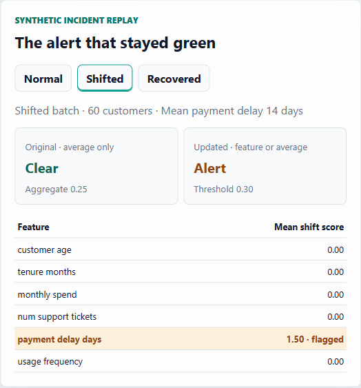
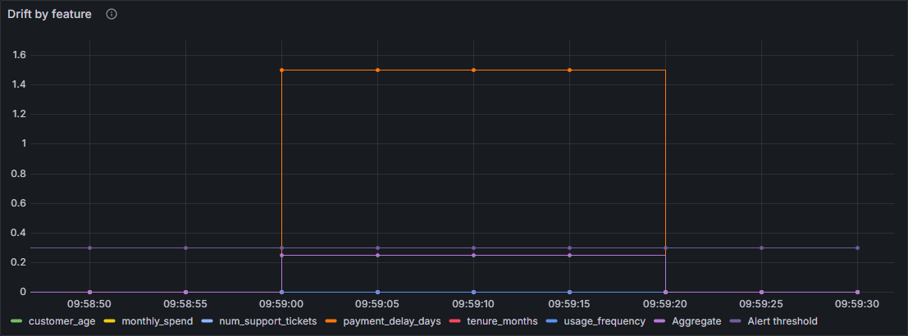
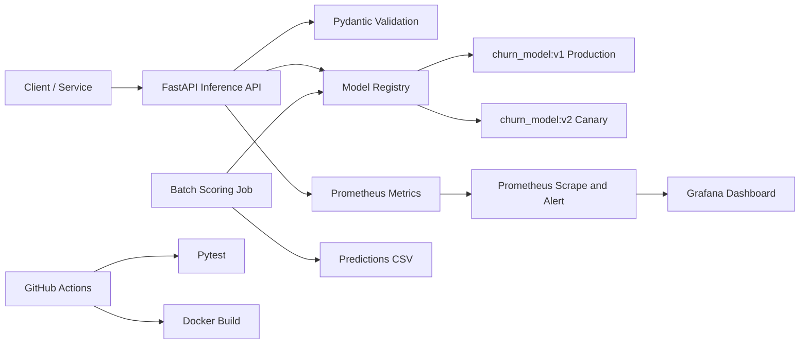

# ML Inference Platform Lab

**A healthy API missed a drift alert because six features were averaged together.**

| Input | What the monitor saw | Decision |
| --- | --- | --- |
| A replay of 60 synthetic customers. Mean payment delay rose from **5 to 14 days**. | Payment delay scored **1.50**. The six-feature average was **0.25**, below the **0.30** threshold. | Alert on the affected feature and keep the aggregate for context. The alert cleared on the recovery batch. |

**Try it locally.** Double-click [`start.bat`](start.bat) on Windows for the API and dashboard. Use [the Docker replay](#replay-the-incident) to watch the full **Normal → Shifted → Recovered** sequence propagate to Prometheus and Grafana. These are measured alerts on synthetic inputs. Churn outcomes were outside the replay.



## Replay the incident

```bash
docker compose up --build -d
```

1. Open the [drift replay](http://127.0.0.1:8000/#drift-replay). Select **Normal** and wait for Prometheus to scrape the batch.
2. Select **Shifted**. Expand **ChurnFeatureMeanShift** in [Prometheus Alerts](http://127.0.0.1:9090/alerts). Within two five-second cycles, it should be firing for `payment_delay_days`. Keep the batch active for ten seconds so Grafana records the shift.
3. Select **Recovered**. Wait for the alert to become inactive, then open the [Grafana dashboard](http://127.0.0.1:3000/d/churn-drift) with the local demo login `admin` / `admin`.



### Input → output

The replay sends 60 records per check. The shifted batch adds nine days to `payment_delay_days` in each record. Other inputs stay fixed. [Baseline records](app/static/drift-replay.json)

| Batch | Mean payment delay | Mean shift score | Payment delay score | Original rule | Updated rule |
| --- | ---: | ---: | ---: | --- | --- |
| Normal | 5 days | 0.00 | 0.00 | Clear | Clear |
| Shifted | 14 days | 0.25 | 1.50 | Clear | Alert |
| Recovered | 5 days | 0.00 | 0.00 | Clear | Clear |

Selected fields from the Shifted batch's API response:

```json
{
  "aggregate_drift_detected": false,
  "drift_detected": true,
  "drift_score": 0.25,
  "features_with_drift": ["payment_delay_days"],
  "threshold": 0.3,
  "sample_size": 60
}
```

The batches are synthetic. The scores, charts and alert states come from running the local stack. This monitors the latest submitted batch against a fixed baseline. Measuring churn recall requires later outcome labels. This replay contains no such labels.

The same lab serves real-time churn predictions, scores CSV batches and simulates version rollout. [Scoring console](docs/assets/live-scoring.png) · [Demo guide](docs/demo-guide.md)

## Architecture



## Features

- Interactive web dashboard for live scoring, canary sampling, readiness, drift checks, and endpoint discovery.
- Windows `start.bat` launcher for recruiter or stakeholder demos.
- Real-time `/predict` endpoint with request IDs, latency tracking, structured logs, and risk labels.
- `/predict/canary` endpoint routing traffic between production and canary model versions.
- JSON model registry with artifact loading through Joblib.
- Synthetic training script that creates two scikit-learn artifacts.
- Batch CSV scoring with schema validation, retries, output validation, and metrics.
- Prometheus metrics for request counts, latency, prediction distribution, model version traffic, batch volume, and drift score.
- Simple drift detection endpoint for feature mean shift.
- Docker Compose stack with API, Prometheus, and Grafana.
- GitHub Actions CI for dependency install, training, linting, tests, and Docker build.

## Tech Stack

Python 3.11, FastAPI, Pydantic, scikit-learn, Pandas, NumPy, Joblib, Prometheus Client, Docker, Docker Compose, Pytest, Ruff, Loguru, and GitHub Actions.

## Real-Time Inference API

`POST /predict` accepts customer features and returns:

```json
{
  "request_id": "abc-123",
  "prediction": 1,
  "churn_probability": 0.82,
  "risk_level": "high",
  "model_name": "churn_model",
  "model_version": "v1",
  "latency_ms": 12.4
}
```

Optional `model_version` can be provided to score with a specific model version. Without it, the production model from `models/model_registry.json` is used.

## Batch Scoring Pipeline

The batch pipeline reads CSV records, validates each row with the same Pydantic contract, loads the production model, scores all records, and writes predictions to `batch/output/predictions.csv`.

## Model Registry & Versioning

`models/model_registry.json` defines model metadata, stages, artifact paths, framework, creation date, and descriptions. `ModelRegistry` loads artifacts, returns the production model, retrieves a specific version, and reports loaded models.

## Canary Deployment Simulation

`POST /predict/canary` routes requests to `v1` or `v2`. The canary percentage is configured with `CANARY_PERCENTAGE` and defaults to 10, simulating a 90/10 production-to-canary rollout.

## Monitoring & Observability

`GET /metrics` exposes Prometheus metrics:

- `inference_request_total`
- `inference_error_total`
- `inference_latency_seconds`
- `prediction_distribution_total`
- `model_version_request_total`
- `batch_records_processed_total`
- `drift_score`, `drift_feature_score{feature="…"}`, and `drift_threshold`

## Drift Detection

`POST /drift/check` compares incoming records with fixed baseline feature means. Each feature score is the absolute mean change divided by its baseline standard deviation. The response preserves the aggregate-only decision for comparison and flags drift if either the aggregate or an individual feature meets the configured threshold. Prometheus evaluates the individual feature alert against the same threshold exported by the API.

## CI/CD

GitHub Actions runs on push and pull request to `main`. The workflow installs dependencies, trains demo artifacts, runs Ruff, executes tests, and builds the Docker image.

## How To Run

Fastest Windows demo:

```bash
start.bat
```

Manual local run:

```bash
make install
make train
make test
make run
```

The API runs at `http://localhost:8000`.

Open the demo dashboard:

```bash
http://localhost:8000
```

For a guided presentation script, see `docs/demo-guide.md`.

With Docker Compose:

```bash
docker compose up --build
```

Services:

- API: `http://localhost:8000`
- Prometheus: `http://localhost:9090`
- Grafana: `http://localhost:3000` with `admin/admin`

## Example Requests

```bash
curl -X POST http://localhost:8000/predict \
  -H "Content-Type: application/json" \
  -d '{
    "customer_age": 32,
    "tenure_months": 14,
    "monthly_spend": 79.5,
    "num_support_tickets": 3,
    "contract_type": "monthly",
    "payment_delay_days": 8,
    "usage_frequency": 12
  }'
```

Canary:

```bash
curl -X POST http://localhost:8000/predict/canary \
  -H "Content-Type: application/json" \
  -d @batch/sample_input.json
```

## Example Batch Command

```bash
python batch/batch_score.py --input batch/sample_input.csv --output batch/output/predictions.csv
```

Or:

```bash
make batch
```

## Metrics

Prometheus scrapes the API on `/metrics`. Grafana can use the included dashboard JSON as a starting point for request volume, latency, routing split, error rate, and drift monitoring.

## Production Considerations

For real deployments, this local lab would typically be extended with Kubernetes, autoscaling, a managed model registry, object storage, API authentication, rate limits, structured audit logs, and production drift windows.

## Future Improvements

- Add MLflow model registry integration.
- Add OpenTelemetry traces.
- Add feature store read paths.
- Add shadow deployment mode.
- Add load tests and SLO-based alerts.
- Add Grafana provisioning for the dashboard.
